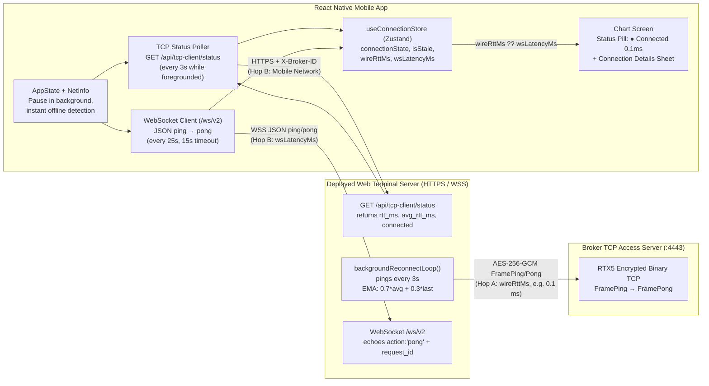
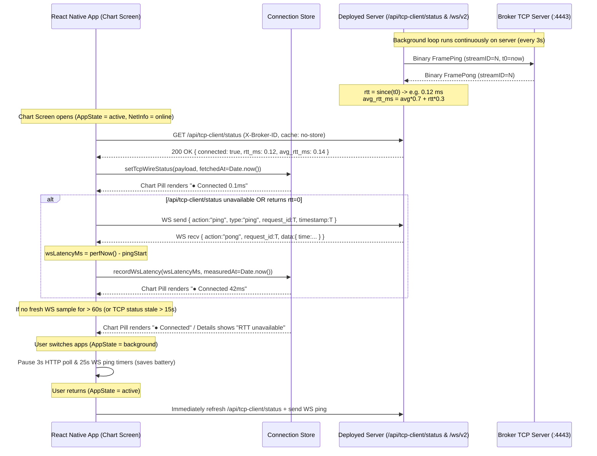

# Mobile App Implementation Prompt: Live Connection Status & RTT (Round-Trip Time) Indicator on Chart (React Native)

> **Copy-paste this entire document to the Mobile App Team / React Native Coding Agent.**
>
> **Parity Reference:** Mirrors the live **Connected + RTT** indicator from the deployed RTX5 Web Terminal (`broker-terminal-ui-tcp-new` + `web-terminal-server`).

---

## 1. Goal (What We Are Building)

Implement the **Live Connection Status & RTT (Round-Trip Time)** indicator in the **React Native** mobile trading application — visible smoothly on the **Chart screen** (status pill / chart header or footer bar) and expandable into a **Connection Details Bottom Sheet / Modal** — with 100% behavioral parity with the deployed web URL (e.g., `https://tcp-terminal.orrnn.com`).

When connected on the deployed URL, users see a compact live pill such as:
- `● Connected 0.1ms` (when broker wire RTT is `0.12 ms`)
- `● Connected 24ms` (when RTT is `24 ms`)
- `● Connected` (when connected, before the first valid RTT sample arrives or after sample expiry)

Tapping the pill opens a **Connection Details Sheet** showing exact millisecond precision (`RTT 0.12 ms` or `RTT unavailable`), health color coding (`< 200 ms` green, `>= 200 ms` yellow), Trade API / Account Stream status, and a **Network Rescan / Reconnect** button.

---

## 2. What Is RTT, What Is Ping/Pong, and Why Does the Deployed URL Show `0.1 ms`?

Every mobile developer implementing this feature **must** understand what this metric is, its purpose, and why the deployed URL often displays ultra-low values like **`0.1 ms`**.

### 2.1 What Is RTT (Plain English + Technical)
- **RTT (Round-Trip Time)** is the total network round-trip delay measured in **milliseconds (`ms`)** — the time from sending a small **Ping** message until the matching **Pong** reply comes back.
- **Ping → Pong Explained:**
  1. The sender starts a high-precision timer and sends a tiny **`ping`** frame ("Are you alive?").
  2. The receiver immediately echoes back a **`pong`** frame ("Yes, I'm here!") carrying the same request/stream ID.
  3. The sender stops the timer when the matching `pong` arrives: `RTT = t_received - t_sent`.
- **Two Purposes of Ping/Pong + RTT:**
  1. **Connection Health / Keep-Alive (Heartbeat):** Detects silent/zombie connections (e.g., mobile network switch from Wi-Fi to 4G/5G, NAT drops, dead tunnel) and triggers automatic reconnect when `pong` times out.
  2. **Live Latency Visibility for Traders:** Shows traders whether the trading connection is fast (`< 200 ms`, green), degraded (`>= 200 ms`, yellow), stale, or disconnected before placing or modifying orders.

### 2.2 Why the Deployed URL Shows `0.1 ms` (CRITICAL Architecture Detail)
There are **two distinct network hops** in the RTX5 deployed architecture:

1. **Hop A — Server-to-Broker Binary TCP Wire RTT (`wireRttMs`, e.g., `0.1 ms`):**
   - `web-terminal-server` maintains an encrypted Binary TCP (`RTX\x05`, X25519 + HKDF-SHA256 + AES-256-GCM) multiplexed tunnel to the broker's TCP Access Server (`:4443`).
   - Every **3 seconds**, `web-terminal-server` sends a binary `FramePing` and measures `FramePong` in microseconds (`MeasurePingRTT`), computes an exponential moving average (`avg_rtt_ms = prevAvg * 0.7 + latestRTT * 0.3`), and exposes both `rtt_ms` and `avg_rtt_ms` on `GET /api/tcp-client/status`.
   - **Why it can be `0.1 ms`:** When `web-terminal-server` and the broker TCP Access Server (`:4443`) run on the **same VPS / loopback (`127.0.0.1:4443`)** or same datacenter LAN, the encrypted Binary TCP ping/pong takes only ~100–200 microseconds (`0.1 ms` – `0.2 ms`).
   - This is the **primary RTT shown on the deployed web URL** next to `Connected`.

2. **Hop B — Mobile Device-to-Server WebSocket RTT (`wsLatencyMs`, e.g., `25 ms – 180 ms`):**
   - Measured directly from the user's phone over Wi-Fi / 4G / 5G to the gateway WebSocket (`/ws/v2`) using JSON `ping` → `pong` frames every **25 seconds** (or on reconnect/resume).
   - Used as the **automatic fallback** whenever `/api/tcp-client/status` is unavailable or returns `0` / disconnected.

> **Product Decision & Recommended UX for Mobile:**
> - **Chart Status Pill (Parity with Deployed URL):** Follow the exact web priority rule: `latencyMs = connectionState === 'connected' ? (wireRttMs ?? wsLatencyMs) : null` so the chart pill matches the deployed URL (`Connected 0.1ms` when connected to a co-located broker, or `Connected 42ms` when falling back to WebSocket RTT).
> - **Connection Details Bottom Sheet (Extra Clarity for Mobile Traders):** Display the primary `RTT 0.12 ms` at the bottom (exact web parity) AND optionally show a breakdown row if both are measured:
>   - **Broker Wire RTT (Server ↔ Broker `:4443`):** `0.12 ms`
>   - **Device Network RTT (Phone ↔ Server):** `38.00 ms`
>   This ensures the mobile user understands why the broker wire RTT is `0.1 ms` while still seeing their own cellular/Wi-Fi latency.

---

## 3. Architecture & Data Flow Charts (Visual Reference)

### 3.1 End-to-End Architecture Chart



### 3.2 Plain-Text Architecture & Hop Chart (For Terminals / Non-Mermaid Viewers)

```text
+-----------------------------------+        Hop B (Mobile 4G/5G/Wi-Fi)        +-------------------------------------+        Hop A (Datacenter / Loopback)        +------------------------------+
|     React Native Mobile App       | <======== 20 ms – 180 ms ==============> |   Deployed Web Terminal Server      | <=========== ~0.1 ms – 20 ms ===========> |  Broker TCP Access Server    |
|                                   |                                          |   (e.g. tcp-terminal.orrnn.com)     |                                           |  (:4443 Encrypted Binary)    |
|  1. Polls /api/tcp-client/status  | --- GET /api/tcp-client/status --------> |  Reads link.rtt() & sess.LastRTTMs  | <--- FramePing / FramePong every 3s ----> |  Echoes FramePong immediately|
|     every 3s (X-Broker-ID header) | <-- { connected, rtt_ms, avg_rtt_ms } -- |  avg_rtt_ms = 0.7*avg + 0.3*rtt     |                                           |                              |
|                                   |                                          |                                     |                                           |                              |
|  2. Fallback WS Heartbeat         | --- { action:"ping", request_id:T } ---> |  rtx5-gateway /ws/v2 handler        |                                           |                              |
|     every 25s (15s pong timeout)  | <-- { action:"pong", request_id:T } ---- |  Echoes request_id immediately      |                                           |                              |
|                                   |                                          |                                     |                                           |                              |
|  Chart Badge: "● Connected 0.1ms" |                                          |                                     |                                           |                              |
|  Sheet Detail: "RTT 0.12 ms"      |                                          |                                     |                                           |                              |
+-----------------------------------+                                          +-------------------------------------+                                           +------------------------------+
```

### 3.3 Sequence Chart (Startup, Live Measurement, Background Pause, Expiry)



---

## 4. Exact Backend Contracts (Verified Against Production Server)

### 4.1 Primary Endpoint: `GET /api/tcp-client/status`

- **Full URL:** `${DEPLOYED_BASE_URL}/api/tcp-client/status` (e.g., `https://tcp-terminal.orrnn.com/api/tcp-client/status`)
- **HTTP Method:** `GET`
- **Required Headers for React Native (Cookieless-Safe):**
  ```http
  Accept: application/json
  Cache-Control: no-store
  X-Broker-ID: <active_broker_id>
  ```
  *(Optional: include `X-RTX5-Session: <session_id>` if the mobile client tracks an RTX5 web session ID. The server's `linkForRequest()` explicitly supports cookieless resolution via `X-Broker-ID`.)*
- **Exact JSON Response Shape:**
  ```json
  {
    "app": "terminal",
    "mode": "web-terminal-tcp",
    "connected": true,
    "magic": "RTX\\x05 (0x52 0x54 0x58 0x05) + RTO\\x01 (:8190 Direct RAM)",
    "cipher": "X25519 + HKDF-SHA256 + AES-256-GCM",
    "target_tcp": "127.0.0.1:4443",
    "fast_order_origin": "https://tcp-terminal.orrnn.com",
    "fast_order_ws_url": "wss://tcp-terminal.orrnn.com/__rtx5_binary_order_ws",
    "broker_id": "orrnn",
    "broker_name": "ORRNN",
    "rtt_ms": 0.12,
    "avg_rtt_ms": 0.14,
    "dll_verified": true,
    "ota": {
      "up_to_date": true
    }
  }
  ```
- **Polling Cadence & Timeout:**
  - Poll interval: **`3000 ms`** (3 seconds) while `AppState === 'active'` and device is online.
  - Per-request timeout: **`4000 ms`** via `AbortController` (prevent overlapping polls on slow cellular networks).
  - Never allow concurrent overlapping requests (guard with an `inFlight` flag).
  - **Mobile Freshness Guard:** Track `tcpStatusFetchedAt = Date.now()`. If the last successful poll is older than **`15_000 ms`** or `connected === false`, treat `wireRttMs` as `null` so the UI never displays a stale frozen `0.1ms` after losing connectivity.

### 4.2 Fallback Endpoint: WebSocket Heartbeat (`ping` → `pong`)

Used on the authenticated `/ws/v2` WebSocket (and if no `wireRttMs` is available):

- **Ping Interval:** Every **`25_000 ms`** (25 seconds) while `ws.readyState === WebSocket.OPEN`, `AppState === 'active'`, and device is online.
- **Outbound Ping Frame (JSON):**
  ```json
  {
    "action": "ping",
    "type": "ping",
    "request_id": 1732094400000,
    "timestamp": 1732094400000
  }
  ```
  - Record `lastPingSentAt = pingTime` (`Date.now()`) and `lastPingStartedAt = monotonicNow()` (`global.performance?.now?.() ?? Date.now()`).
- **Inbound Pong Frame (JSON):**
  ```json
  {
    "action": "pong",
    "request_id": 1732094400000,
    "data": { "time": 1732094400042 }
  }
  ```
  - Match pong when `msg.action === 'pong' || msg.type === 'pong'`.
  - Extract echoed ID with exact web fallback order:
    ```ts
    const echo =
      msg.request_id ??
      msg.data?.request_id ??
      msg.ping_timestamp ??
      msg.request_timestamp ??
      msg.timestamp ??
      msg.data?.timestamp;
    ```
  - Only record RTT when `lastPingSentAt > 0 && Number(echo) === lastPingSentAt`:
    ```ts
    const latency = monotonicNow() - lastPingStartedAt;
    if (Number.isFinite(latency) && latency >= 0) {
      const measuredMs = Math.max(0.1, Number(latency.toFixed(2))); // or Math.floor(latency) for integer WS parity
      // store lastLatency = measuredMs, latencyMeasuredAt = Date.now()
      // push to rolling window (max 100 samples) for averageLatency
    }
    ```
- **Pong Timeout & Dead-Socket Detection:**
  - Timeout: **`15_000 ms`** (15 seconds).
  - If the timeout fires AND no inbound data frame (`lastDataTime <= pingTime`) arrived on the socket since the ping was sent:
    - Close the WebSocket with code `4000` (`"WebSocket heartbeat timeout"`).
    - Set connection state to `'disconnected'` → `'reconnecting'`.
    - Reconnect with exponential backoff (`1000 ms` base, `30_000 ms` max, +0–20% random jitter).
- **Sample Expiry:**
  - A WebSocket RTT sample is valid **only** if `Date.now() - latencyMeasuredAt <= 60_000` (60 seconds) AND `connectionState === 'connected'`.
  - After 60 seconds without a fresh measurement, `wsLatencyMs` becomes `null` and the details sheet shows **`RTT unavailable`**.

---

## 5. Exact UI Specification & Formatting Charts (For Chart Screen & Details Sheet)

### 5.1 Priority & Resolution Rules Table

| Step | Variable | Exact Rule |
| :--- | :--- | :--- |
| 1 | `wireRttMs` | If `tcpStatus.connected !== false` AND `now - tcpStatusFetchedAt <= 15_000`: use `tcpStatus.avg_rtt_ms` if `> 0`, else `tcpStatus.rtt_ms` if `> 0`, else `null`. |
| 2 | `wsLatencyMs` | If `connectionState === 'connected'` AND `lastLatency > 0` AND `latencyMeasuredAt !== null` AND `now - latencyMeasuredAt <= 60_000`: use `lastLatency`, else `null`. |
| 3 | `latencyMs` | If `connectionState === 'connected'`: `wireRttMs ?? wsLatencyMs`, else `null`. |

### 5.2 Number Formatting Rules Table

| Location | Condition | Output Format | Examples |
| :--- | :--- | :--- | :--- |
| **Chart Pill** (`formatWireLatency`) | `ms < 1` | `${ms.toFixed(1)}ms` | `0.1ms`, `0.4ms` |
| **Chart Pill** (`formatWireLatency`) | `1 <= ms < 10` | `${ms.toFixed(1)}ms` | `1.2ms`, `8.7ms` |
| **Chart Pill** (`formatWireLatency`) | `ms >= 10` | `${Math.round(ms)}ms` | `24ms`, `178ms`, `800ms` |
| **Chart Pill** (no RTT yet) | `latencyMs === null` | `Connected` | `Connected` |
| **Details Bottom Sheet** | `latencyMs !== null` | `RTT ${latencyMs.toFixed(2)} ms` | `RTT 0.12 ms`, `RTT 24.50 ms` |
| **Details Bottom Sheet** | `latencyMs === null` | `RTT unavailable` | `RTT unavailable` |

### 5.3 Connection State Visual Chart

| Condition / State | Status Dot Color | Pill Text | Icon |
| :--- | :--- | :--- | :--- |
| `isStale === true` | Orange (`#F97316`) | `Stale Data (Stale)` | Warning triangle |
| `connected` (with RTT) | Green (`#22C55E`) | `Connected 0.1ms` | Wi-Fi |
| `connected` (no RTT) | Green (`#22C55E`) | `Connected` | Wi-Fi |
| `connecting` | Yellow (`#EAB308`) | `Connecting...` | Spinning refresh |
| `reconnecting` | Yellow (`#EAB308`) | `Reconnecting to server…` | Spinning refresh |
| `disconnected` | Red (`#EF4444`) | `Disconnected` | Wi-Fi Off |
| `offline` | Gray (`#6B7280`) | `Offline` | Wi-Fi Off |
| `error` | Dark Red (`#DC2626`) | `Error` | Alert triangle |

### 5.4 Latency Health Color Thresholds (Details Sheet)

| Condition | Dark Theme Color | Light Theme Color | Meaning |
| :--- | :--- | :--- | :--- |
| `latencyMs !== null && latencyMs < 200` | `#4ADE80` (Green) | `#16A34A` (Green) | Fast / healthy |
| `latencyMs === null \|\| latencyMs >= 200` | `#FACC15` (Yellow) | `#CA8A04` (Amber/Yellow) | High latency or unavailable |

### 5.5 Placement & Layout on the Mobile Chart Screen

Place the compact interactive pill (`<ChartConnectionBadge />`) where it is **always visible on the Chart screen** without blocking candlesticks, crosshair tooltips, price scale, or Quick Buy/Sell buttons:
- **Recommended Position:** Right side of the **Chart Top Info Bar** (beside Symbol & Timeframe, e.g., `EURUSD · M1` on the left, `● Connected 0.1ms` pill on the right) OR docked in a slim **Chart Bottom Status Strip** (`24px–28px` height, matching the desktop/web status bar).
- **Typography:** Use tabular numerals (`fontVariant: ['tabular-nums']` in React Native `TextStyle`) so changing digits (`0.1ms` → `0.2ms` → `12ms`) **never cause horizontal layout jitter** on the chart header.
- **Hit Slop:** Add `hitSlop={{ top: 8, bottom: 8, left: 8, right: 8 }}` so the compact pill is effortless to tap on touchscreens.
- **Tap Action → Connection Details Bottom Sheet / Modal:**
  - Connection status + active broker name & TCP endpoint (`target_tcp`, e.g., `:4443`)
  - Primary RTT row: `RTT 0.12 ms` (green `< 200 ms`, yellow `>= 200 ms`) or `RTT unavailable`
  - Optional hop breakdown rows (when both exist):
    - `Broker Wire RTT`: `0.12 ms` (Server ↔ Broker `:4443`)
    - `Device Network RTT`: `38.00 ms` (Phone ↔ Server WebSocket)
  - `Trade API` status (`ready` / `syncing` / `REST error`)
  - `Account Stream` status (`live` / `polling`)
  - **`Network Rescan`** action button (triggers full WebSocket reconnect + immediate `/api/tcp-client/status` refresh)

---

## 6. Reference React Native (TypeScript) Implementation Blueprint

Create clean, modular files — **zero DOM APIs (`window`, `document`)**, fully React Native compatible (iOS & Android, Hermes / JSC).

### 6.1 Formatting & Resolution Utilities (`src/utils/rttFormat.ts`)

```ts
export type ConnectionState =
  | 'connecting'
  | 'connected'
  | 'disconnected'
  | 'reconnecting'
  | 'error'
  | 'offline';

export interface TcpWireStatus {
  connected?: boolean;
  rtt_ms?: number;
  avg_rtt_ms?: number;
  target_tcp?: string;
  broker_id?: string;
  broker_name?: string;
  mode?: string;
}

export const TCP_STATUS_POLL_INTERVAL_MS = 3_000;
export const TCP_STATUS_FETCH_TIMEOUT_MS = 4_000;
export const TCP_STATUS_MAX_AGE_MS = 15_000;

export const WS_PING_INTERVAL_MS = 25_000;
export const WS_PONG_TIMEOUT_MS = 15_000;
export const WS_LATENCY_MAX_AGE_MS = 60_000;

export const formatWireLatency = (ms: number): string => {
  if (ms < 1) return `${ms.toFixed(1)}ms`;
  if (ms < 10) return `${ms.toFixed(1)}ms`;
  return `${Math.round(ms)}ms`;
};

export const formatDetailedRtt = (ms: number | null): string =>
  ms !== null ? `RTT ${ms.toFixed(2)} ms` : 'RTT unavailable';

export const isHealthyRtt = (ms: number | null): boolean =>
  ms !== null && ms > 0 && ms < 200;

export const monotonicNow = (): number =>
  typeof globalThis.performance?.now === 'function'
    ? globalThis.performance.now()
    : Date.now();

export function resolveDisplayedRttMs(params: {
  connectionState: ConnectionState;
  now: number;
  tcpStatus: TcpWireStatus | null;
  tcpStatusFetchedAt: number | null;
  wsLastLatencyMs: number;
  wsLatencyMeasuredAt: number | null;
}): {
  latencyMs: number | null;
  wireRttMs: number | null;
  wsLatencyMs: number | null;
  source: 'tcp_wire' | 'ws_ping' | 'none';
} {
  const {
    connectionState,
    now,
    tcpStatus,
    tcpStatusFetchedAt,
    wsLastLatencyMs,
    wsLatencyMeasuredAt,
  } = params;

  const tcpFresh =
    tcpStatus !== null &&
    tcpStatus.connected !== false &&
    tcpStatusFetchedAt !== null &&
    now - tcpStatusFetchedAt <= TCP_STATUS_MAX_AGE_MS;

  const wireRttMs = tcpFresh
    ? typeof tcpStatus.avg_rtt_ms === 'number' && tcpStatus.avg_rtt_ms > 0
      ? tcpStatus.avg_rtt_ms
      : typeof tcpStatus.rtt_ms === 'number' && tcpStatus.rtt_ms > 0
        ? tcpStatus.rtt_ms
        : null
    : null;

  const wsLatencyMs =
    connectionState === 'connected' &&
    wsLastLatencyMs > 0 &&
    wsLatencyMeasuredAt !== null &&
    now - wsLatencyMeasuredAt <= WS_LATENCY_MAX_AGE_MS
      ? wsLastLatencyMs
      : null;

  if (connectionState !== 'connected') {
    return { latencyMs: null, wireRttMs, wsLatencyMs: null, source: 'none' };
  }

  if (wireRttMs !== null) {
    return { latencyMs: wireRttMs, wireRttMs, wsLatencyMs, source: 'tcp_wire' };
  }
  if (wsLatencyMs !== null) {
    return { latencyMs: wsLatencyMs, wireRttMs: null, wsLatencyMs, source: 'ws_ping' };
  }
  return { latencyMs: null, wireRttMs: null, wsLatencyMs: null, source: 'none' };
}
```

### 6.2 Dedicated Connection Telemetry Store (`src/store/useConnectionTelemetryStore.ts`)

> **Why a dedicated store?** Updating RTT every 3 seconds must **never** trigger re-renders in the heavy candlestick chart, order book, or Market Watch list. Only `<ChartConnectionBadge />` and `<ConnectionDetailsSheet />` subscribe to this store.

```ts
import { create } from 'zustand';
import type { ConnectionState, TcpWireStatus } from '../utils/rttFormat';

interface ConnectionTelemetryState {
  connectionState: ConnectionState;
  isStale: boolean;
  isOnline: boolean;

  // Source 1: Deployed server TCP wire RTT (/api/tcp-client/status)
  tcpStatus: TcpWireStatus | null;
  tcpStatusFetchedAt: number | null;

  // Source 2: Mobile WebSocket ping/pong RTT (/ws/v2)
  wsLastLatencyMs: number;
  wsAverageLatencyMs: number;
  wsLatencyMeasuredAt: number | null;
  wsLatencySamples: number[];

  // Actions
  setConnectionState: (state: ConnectionState) => void;
  setStale: (stale: boolean) => void;
  setOnline: (online: boolean) => void;
  setTcpStatus: (status: TcpWireStatus, fetchedAt?: number) => void;
  clearTcpStatus: () => void;
  recordWsLatency: (latencyMs: number, measuredAt?: number) => void;
  resetWsLatency: () => void;
}

export const useConnectionTelemetryStore = create<ConnectionTelemetryState>((set) => ({
  connectionState: 'disconnected',
  isStale: false,
  isOnline: true,

  tcpStatus: null,
  tcpStatusFetchedAt: null,

  wsLastLatencyMs: 0,
  wsAverageLatencyMs: 0,
  wsLatencyMeasuredAt: null,
  wsLatencySamples: [],

  setConnectionState: (connectionState) => set({ connectionState }),
  setStale: (isStale) => set({ isStale }),
  setOnline: (isOnline) =>
    set((prev) => ({
      isOnline,
      connectionState: isOnline ? prev.connectionState : 'offline',
    })),

  setTcpStatus: (tcpStatus, fetchedAt = Date.now()) =>
    set({ tcpStatus, tcpStatusFetchedAt: fetchedAt }),

  clearTcpStatus: () => set({ tcpStatus: null, tcpStatusFetchedAt: null }),

  recordWsLatency: (latencyMs, measuredAt = Date.now()) =>
    set((prev) => {
      if (!Number.isFinite(latencyMs) || latencyMs < 0) return prev;
      const samples = [...prev.wsLatencySamples, latencyMs].slice(-100);
      const avg = samples.reduce((sum, v) => sum + v, 0) / samples.length;
      return {
        wsLastLatencyMs: latencyMs,
        wsAverageLatencyMs: avg,
        wsLatencyMeasuredAt: measuredAt,
      };
    }),

  resetWsLatency: () =>
    set({
      wsLastLatencyMs: 0,
      wsAverageLatencyMs: 0,
      wsLatencyMeasuredAt: null,
      wsLatencySamples: [],
    }),
}));
```

### 6.3 Battery-Safe TCP Status Poller Hook (`src/hooks/useTcpStatusPoller.ts`)

Handles `AppState` (pauses in background, refreshes immediately on foreground), `@react-native-community/netinfo` (pauses when offline), `AbortController` timeouts, and cookieless `X-Broker-ID` header.

```ts
import { useCallback, useEffect, useRef } from 'react';
import { AppState, type AppStateStatus } from 'react-native';
import NetInfo from '@react-native-community/netinfo';
import { useConnectionTelemetryStore } from '../store/useConnectionTelemetryStore';
import {
  TCP_STATUS_FETCH_TIMEOUT_MS,
  TCP_STATUS_POLL_INTERVAL_MS,
  type TcpWireStatus,
} from '../utils/rttFormat';

interface UseTcpStatusPollerOptions {
  baseUrl: string; // e.g., "https://tcp-terminal.orrnn.com"
  brokerId?: string;
  sessionId?: string;
  enabled?: boolean;
}

export function useTcpStatusPoller({
  baseUrl,
  brokerId,
  sessionId,
  enabled = true,
}: UseTcpStatusPollerOptions) {
  const inFlightRef = useRef(false);
  const abortRef = useRef<AbortController | null>(null);
  const appStateRef = useRef<AppStateStatus>(AppState.currentState);
  const isOnlineRef = useRef(true);

  const fetchOnce = useCallback(async () => {
    if (!enabled || !baseUrl || inFlightRef.current) return;
    if (appStateRef.current !== 'active' || !isOnlineRef.current) return;

    inFlightRef.current = true;
    const controller = new AbortController();
    abortRef.current = controller;
    const timeoutId = setTimeout(() => controller.abort(), TCP_STATUS_FETCH_TIMEOUT_MS);

    try {
      const headers: Record<string, string> = {
        Accept: 'application/json',
        'Cache-Control': 'no-store',
      };
      if (brokerId) headers['X-Broker-ID'] = brokerId;
      if (sessionId) headers['X-RTX5-Session'] = sessionId;

      const url = `${baseUrl.replace(/\/+$/, '')}/api/tcp-client/status`;
      const res = await fetch(url, {
        method: 'GET',
        headers,
        cache: 'no-store',
        signal: controller.signal,
      });

      if (!res.ok) return;
      const payload = (await res.json()) as TcpWireStatus;
      useConnectionTelemetryStore.getState().setTcpStatus(payload, Date.now());
    } catch {
      // Ignore abort/transient errors; freshness guard expires stale wireRttMs after 15s
    } finally {
      clearTimeout(timeoutId);
      inFlightRef.current = false;
      if (abortRef.current === controller) abortRef.current = null;
    }
  }, [baseUrl, brokerId, sessionId, enabled]);

  useEffect(() => {
    if (!enabled || !baseUrl) return;

    const unsubNet = NetInfo.addEventListener((state) => {
      const online = Boolean(state.isConnected && state.isInternetReachable !== false);
      isOnlineRef.current = online;
      useConnectionTelemetryStore.getState().setOnline(online);
      if (!online) {
        abortRef.current?.abort();
      } else {
        void fetchOnce();
      }
    });

    const appSub = AppState.addEventListener('change', (nextState) => {
      appStateRef.current = nextState;
      if (nextState === 'active') {
        void fetchOnce();
      } else {
        abortRef.current?.abort();
      }
    });

    void fetchOnce();
    const timer = setInterval(() => {
      void fetchOnce();
    }, TCP_STATUS_POLL_INTERVAL_MS);

    return () => {
      clearInterval(timer);
      abortRef.current?.abort();
      appSub.remove();
      unsubNet();
    };
  }, [baseUrl, enabled, fetchOnce]);

  return { refreshNow: fetchOnce };
}
```

### 6.4 WebSocket Ping/Pong RTT Integration (Inside Your Existing WS Service)

Wire these exact hooks into the mobile app's `/ws/v2` WebSocket client:

```ts
import { useConnectionTelemetryStore } from '../store/useConnectionTelemetryStore';
import {
  WS_PING_INTERVAL_MS,
  WS_PONG_TIMEOUT_MS,
  monotonicNow,
} from '../utils/rttFormat';

// On WS open:
//   useConnectionTelemetryStore.getState().setConnectionState('connected');
//   startPingInterval();
//   sendPing(); // Optional immediate first ping so fallback RTT populates right away

// Inside sendPing():
const pingTime = Date.now();
this.lastPingSentAt = pingTime;
this.lastPingStartedAt = monotonicNow();
socket.send(
  JSON.stringify({
    action: 'ping',
    type: 'ping',
    request_id: pingTime,
    timestamp: pingTime,
  }),
);
this.pongTimeout = setTimeout(() => {
  if (this.lastDataTime > pingTime) return; // Stream still delivering frames
  socket.close(4000, 'WebSocket heartbeat timeout');
}, WS_PONG_TIMEOUT_MS);

// Inside onMessage(raw):
this.lastDataTime = Date.now();
if (msg.action === 'pong' || msg.type === 'pong') {
  if (this.pongTimeout) {
    clearTimeout(this.pongTimeout);
    this.pongTimeout = null;
  }
  const echo =
    msg.request_id ??
    msg.data?.request_id ??
    msg.ping_timestamp ??
    msg.request_timestamp ??
    msg.timestamp ??
    msg.data?.timestamp;

  if (this.lastPingSentAt > 0 && Number(echo) === this.lastPingSentAt) {
    const rttMs = monotonicNow() - this.lastPingStartedAt;
    useConnectionTelemetryStore.getState().recordWsLatency(rttMs, Date.now());
    this.lastPingSentAt = 0;
  }
}

// On WS close / reconnect:
//   stopPingInterval();
//   useConnectionTelemetryStore.getState().resetWsLatency();
//   useConnectionTelemetryStore.getState().setConnectionState('reconnecting');
```

### 6.5 Chart Connection Pill & Details Modal (`src/components/ChartConnectionBadge.tsx`)

Wrap in `React.memo` so it runs independently of the chart's 60fps tick/canvas loop:

```tsx
import React, { memo, useEffect, useState } from 'react';
import { Modal, Pressable, StyleSheet, Text, View } from 'react-native';
import { useConnectionTelemetryStore } from '../store/useConnectionTelemetryStore';
import {
  formatDetailedRtt,
  formatWireLatency,
  isHealthyRtt,
  resolveDisplayedRttMs,
} from '../utils/rttFormat';

interface ChartConnectionBadgeProps {
  onReconnect: () => void;
  tradeApiState?: 'ready' | 'syncing' | 'error';
}

export const ChartConnectionBadge = memo(function ChartConnectionBadge({
  onReconnect,
  tradeApiState = 'ready',
}: ChartConnectionBadgeProps) {
  const [sheetOpen, setSheetOpen] = useState(false);
  const [now, setNow] = useState(Date.now);

  const connectionState = useConnectionTelemetryStore((s) => s.connectionState);
  const isStale = useConnectionTelemetryStore((s) => s.isStale);
  const tcpStatus = useConnectionTelemetryStore((s) => s.tcpStatus);
  const tcpStatusFetchedAt = useConnectionTelemetryStore((s) => s.tcpStatusFetchedAt);
  const wsLastLatencyMs = useConnectionTelemetryStore((s) => s.wsLastLatencyMs);
  const wsLatencyMeasuredAt = useConnectionTelemetryStore((s) => s.wsLatencyMeasuredAt);

  // 1-second local tick only inside this tiny component to expire stale RTT samples cleanly
  useEffect(() => {
    const id = setInterval(() => setNow(Date.now()), 1000);
    return () => clearInterval(id);
  }, []);

  const { latencyMs, wireRttMs, wsLatencyMs } = resolveDisplayedRttMs({
    connectionState,
    now,
    tcpStatus,
    tcpStatusFetchedAt,
    wsLastLatencyMs,
    wsLatencyMeasuredAt,
  });

  const dotColor = isStale
    ? '#F97316'
    : connectionState === 'connected'
      ? '#22C55E'
      : connectionState === 'connecting' || connectionState === 'reconnecting'
        ? '#EAB308'
        : connectionState === 'offline'
          ? '#6B7280'
          : '#EF4444';

  const pillLabel = isStale
    ? 'Stale Data'
    : connectionState === 'connected'
      ? latencyMs !== null
        ? `Connected ${formatWireLatency(latencyMs)}`
        : 'Connected'
      : connectionState === 'reconnecting'
        ? 'Reconnecting…'
        : connectionState === 'connecting'
          ? 'Connecting…'
          : connectionState === 'offline'
            ? 'Offline'
            : 'Disconnected';

  const rttColor = isHealthyRtt(latencyMs) ? '#4ADE80' : '#FACC15';

  return (
    <>
      <Pressable
        onPress={() => setSheetOpen(true)}
        hitSlop={8}
        accessibilityRole="button"
        accessibilityLabel={`Connection status: ${pillLabel}`}
        style={styles.pill}
      >
        <View style={[styles.dot, { backgroundColor: dotColor }]} />
        <Text style={styles.pillText} numberOfLines={1}>
          {pillLabel}
        </Text>
      </Pressable>

      <Modal
        visible={sheetOpen}
        transparent
        animationType="fade"
        onRequestClose={() => setSheetOpen(false)}
      >
        <Pressable style={styles.backdrop} onPress={() => setSheetOpen(false)}>
          <Pressable style={styles.sheet} onPress={() => {}}>
            <Text style={styles.sheetTitle}>Connection Details</Text>

            <View style={styles.row}>
              <Text style={styles.label}>Status</Text>
              <Text style={[styles.value, { color: dotColor }]}>{pillLabel}</Text>
            </View>

            {tcpStatus?.target_tcp ? (
              <View style={styles.row}>
                <Text style={styles.label}>Broker TCP Server</Text>
                <Text style={styles.monoValue}>{tcpStatus.target_tcp}</Text>
              </View>
            ) : null}

            <View style={styles.row}>
              <Text style={styles.label}>Trade API</Text>
              <Text style={styles.monoValue}>{tradeApiState}</Text>
            </View>

            <View style={styles.row}>
              <Text style={styles.label}>Account Stream</Text>
              <Text style={styles.monoValue}>
                {connectionState === 'connected' ? 'live' : 'polling'}
              </Text>
            </View>

            {wireRttMs !== null && wsLatencyMs !== null ? (
              <>
                <View style={styles.row}>
                  <Text style={styles.label}>Broker Wire RTT (Server ↔ :4443)</Text>
                  <Text style={styles.monoValue}>{wireRttMs.toFixed(2)} ms</Text>
                </View>
                <View style={styles.row}>
                  <Text style={styles.label}>Device Network RTT (Phone ↔ Server)</Text>
                  <Text style={styles.monoValue}>{wsLatencyMs.toFixed(2)} ms</Text>
                </View>
              </>
            ) : null}

            <View style={styles.rttFooter}>
              <Text style={[styles.rttFooterText, { color: rttColor }]}>
                {formatDetailedRtt(latencyMs)}
              </Text>
            </View>

            <Pressable
              style={styles.rescanBtn}
              onPress={() => {
                setSheetOpen(false);
                onReconnect();
              }}
            >
              <Text style={styles.rescanBtnText}>Network Rescan</Text>
            </Pressable>
          </Pressable>
        </Pressable>
      </Modal>
    </>
  );
});

const styles = StyleSheet.create({
  pill: {
    flexDirection: 'row',
    alignItems: 'center',
    gap: 6,
    paddingHorizontal: 8,
    paddingVertical: 4,
    borderRadius: 6,
    backgroundColor: 'rgba(30, 34, 45, 0.85)',
  },
  dot: {
    width: 8,
    height: 8,
    borderRadius: 4,
  },
  pillText: {
    color: '#E5E7EB',
    fontSize: 12,
    fontVariant: ['tabular-nums'],
  },
  backdrop: {
    flex: 1,
    backgroundColor: 'rgba(0,0,0,0.55)',
    justifyContent: 'flex-end',
  },
  sheet: {
    backgroundColor: '#1E222D',
    borderTopLeftRadius: 16,
    borderTopRightRadius: 16,
    borderWidth: 1,
    borderColor: '#3A3E4A',
    padding: 16,
    gap: 10,
  },
  sheetTitle: {
    color: '#F3F4F6',
    fontSize: 15,
    fontWeight: '600',
    marginBottom: 4,
  },
  row: {
    flexDirection: 'row',
    justifyContent: 'space-between',
    alignItems: 'center',
  },
  label: {
    color: '#9CA3AF',
    fontSize: 13,
  },
  value: {
    fontSize: 13,
    fontWeight: '600',
  },
  monoValue: {
    color: '#E5E7EB',
    fontSize: 12,
    fontVariant: ['tabular-nums'],
  },
  rttFooter: {
    marginTop: 4,
    paddingVertical: 8,
    paddingHorizontal: 10,
    borderRadius: 8,
    backgroundColor: '#161921',
  },
  rttFooterText: {
    fontSize: 12,
    fontWeight: '600',
    fontVariant: ['tabular-nums'],
  },
  rescanBtn: {
    marginTop: 6,
    backgroundColor: '#2962FF',
    borderRadius: 8,
    paddingVertical: 11,
    alignItems: 'center',
  },
  rescanBtnText: {
    color: '#FFFFFF',
    fontSize: 13,
    fontWeight: '600',
  },
});
```

---

## 7. Hard Rules & Edge Cases (Do NOT Skip)

1. **NEVER Fake or Hardcode RTT:** Never invent simulated latency numbers when disconnected or waiting for the first ping/pong. Always display `Connected` (on pill) and `RTT unavailable` (in details sheet) until a real measurement arrives.
2. **NEVER Re-Render the Chart Canvas:** Keep the 1-second expiry clock and 3-second RTT state isolated inside `<ChartConnectionBadge />` + `useConnectionTelemetryStore`. Do not pass `latencyMs` as a prop into the chart rendering component.
3. **Pause in Background (iOS & Android Battery Compliance):** Stop both the 3-second `/api/tcp-client/status` poll and 25-second WebSocket heartbeat when `AppState !== 'active'`, and immediately refresh + ping on returning to `'active'`.
4. **Prevent Stale Frozen `0.1ms` on Network Drop:** Immediately clear/hide RTT when `NetInfo` reports offline, when `tcpStatus.connected === false`, when TCP status hasn't succeeded in `> 15 s`, or when WS ping hasn't succeeded in `> 60 s`.
5. **Broker Isolation:** Always send `X-Broker-ID` on `/api/tcp-client/status` and reset stored `tcpStatus` + `wsLatency` immediately when the user switches broker or logs out.
6. **Monotonic Clock:** Use `performance.now()` (not `Date.now()`) to subtract start/end timestamps for WebSocket RTT so NTP / carrier clock jumps never produce negative or bogus millisecond readings.
7. **Tabular Numerals:** Always apply `fontVariant: ['tabular-nums']` to RTT text so the Chart header never shifts horizontally as numbers update.

---

## 8. Verification & QA Checklist

- [ ] **Deployed URL Parity (`0.1 ms` case):** Connected to deployed `web-terminal-server` with co-located `:4443` broker → Chart pill displays `● Connected 0.1ms` (1 decimal for `< 10 ms`), tapping opens details showing `RTT 0.12 ms` (2 decimals) in **green**.
- [ ] **Higher Latency Formatting:** When RTT is `178.4 ms` → pill shows `Connected 178ms`, details shows `RTT 178.40 ms` in **green**; when RTT is `250.0 ms` → pill shows `Connected 250ms`, details shows `RTT 250.00 ms` in **yellow**.
- [ ] **WebSocket Fallback:** When `/api/tcp-client/status` is disabled or unreachable, `/ws/v2` JSON `ping` → `pong` populates RTT cleanly; advancing > 60 seconds without a pong expires it to `RTT unavailable`.
- [ ] **Airplane Mode / Offline:** Enabling Airplane Mode immediately transitions pill to `● Offline` (gray) with no frozen `0.1ms`; re-enabling Wi-Fi/5G auto-recovers to `Connected <X>ms`.
- [ ] **Background → Foreground:** Backgrounding app stops network polling (verify in proxy/network inspector); returning to foreground refreshes RTT within `< 1 s`.
- [ ] **Network Rescan:** Tapping **Network Rescan** in the details sheet reconnects sockets and immediately refreshes `/api/tcp-client/status`.
- [ ] **Chart Performance:** Profiling with React DevTools / Flipper confirms zero extra re-renders of the Chart candlestick component during 1s/3s RTT ticks.
